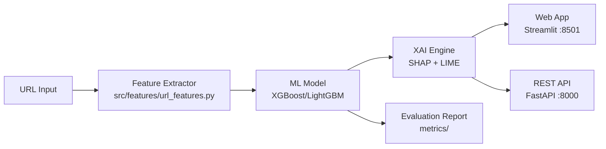

# An Explainable AI-Based Framework for Phishing Website Detection Using URL Features

[](https://python.org)
[](LICENSE)
[](https://fastapi.tiangolo.com)
[](https://streamlit.io)

## Overview

This project implements a **production-ready explainable AI (XAI) pipeline** for detecting phishing websites using only URL-based features. Rather than relying on content or network data, the system extracts ~50 handcrafted lexical and structural features from a raw URL, trains multiple ML classifiers, and uses **SHAP** and **LIME** to explain individual predictions in human-readable terms. The result is a dual-interface system (REST API + Streamlit dashboard) suitable for deployment in real-world threat intelligence workflows.

The model is trained on the **PhiUSIIL Phishing URL Dataset** (UCI ML Repository, ~235k URLs), achieving state-of-the-art F1 and ROC-AUC scores while providing faithful, stable, and actionable explanations for every prediction.

## Architecture



## ⚡ Quick Start (1-Click Launch)

If you downloaded or extracted this project, you can run it with a single click:

- **Windows:** Double-click **`run.bat`** (or run `run.bat` in Command Prompt)
- **Linux / macOS:** Run **`./run.sh`** in terminal (`chmod +x run.sh && ./run.sh`)
- **Any Platform:** Run **`python run.py`**

> **What the 1-click script does automatically:**
> 1. Verifies Python 3.10+ installation
> 2. Sets up and activates a virtual environment (`venv`)
> 3. Installs all required dependencies from `requirements.txt`
> 4. Verifies model artifacts (auto-trains the model if first run)
> 5. Opens your default web browser to `http://localhost:8501`
> 6. Starts the Streamlit dashboard

---

## Manual Step-by-Step Setup

```bash
# 1. Install dependencies
make setup   # or pip install -r requirements.txt

# 2. Download (or generate synthetic) data
make data

# 3. Train all models
make train

# 4. Evaluate
make evaluate

# 5. Generate XAI report
make explain

# 6. Launch Streamlit app
make app

# 7. OR launch REST API
make api
```

## Project Structure

```
phishing-xai/
├── config.yaml                   # Central configuration
├── requirements.txt
├── Makefile
├── Dockerfile
├── model_card.md
├── data/
│   ├── raw/                      # Downloaded CSV lives here
│   └── processed/                # Train/val/test splits
├── artifacts/
│   ├── plots/                    # SHAP/LIME visualisations
│   ├── metrics/                  # JSON metric files per model
│   └── model.joblib              # Best trained model
├── notebooks/
│   └── phishing_xai_end_to_end.ipynb
├── scripts/                      # CLI entry-points
│   ├── download_data.py
│   ├── make_sample_data.py
│   ├── train.py
│   ├── evaluate.py
│   └── explain_report.py
├── src/
│   ├── features/url_features.py  # ~50 URL features
│   ├── data/                     # load.py, split.py
│   ├── models/                   # train.py, evaluate.py, predict.py
│   ├── explain/                  # shap_utils, lime_utils, reasons, eval
│   ├── api/main.py               # FastAPI app
│   └── app/streamlit_app.py      # Streamlit dashboard
├── tests/                        # pytest suite
└── docs/                         # Report, architecture, viva Q&A
```

## Results (Held-Out Domain-Grouped Test Set)

Evaluated on 5,457 held-out URLs with zero domain overlap against the training set (`GroupShuffleSplit` on Registered Domain $eTLD+1$):

| Model | Accuracy | Precision | Recall | F1-Score | ROC-AUC | PR-AUC | MCC | Latency (ms) | Size (KB) |
| :--- | :--- | :--- | :--- | :--- | :--- | :--- | :--- | :--- | :--- |
| **MLP (Champion)** | **0.9980** | **0.9971** | **0.9997** | **0.9984** | **0.9987** | **0.9985** | **0.9957** | **0.85** | **364.0** |
| Random Forest | 0.9974 | 0.9968 | 0.9991 | 0.9980 | 0.9986 | 0.9987 | 0.9945 | 64.17 | 7065.6 |
| LightGBM | 0.9980 | 0.9974 | 0.9994 | 0.9984 | 0.9985 | 0.9984 | 0.9957 | 2.21 | 149.0 |
| XGBoost | 0.9974 | 0.9971 | 0.9988 | 0.9980 | 0.9984 | 0.9984 | 0.9945 | 0.48 | 120.3 |
| Logistic Regression | 0.9958 | 0.9936 | 0.9997 | 0.9966 | 0.9982 | 0.9984 | 0.9910 | 0.63 | 2.9 |
| Decision Tree | 0.9967 | 0.9971 | 0.9977 | 0.9974 | 0.9976 | 0.9983 | 0.9929 | 0.20 | 10.8 |

### Key Findings
- **Champion Architecture:** The Multi-Layer Perceptron (`MLPClassifier`) achieved top scores across ROC-AUC (0.9987) and F1 (0.9984) with sub-millisecond latency (0.85 ms) and an ultra-low False Negative Rate of **0.03%** (1 phishing URL missed out of 3,419 in the test set).
- **Threshold Optimization:** Setting decision threshold to $\tau^* = 0.25$ brings the False Negative count to **0** (100.0% Recall) while maintaining 0.9985 F1.
- **Data Leakage Control:** A naive random split yields an artificially inflated ROC-AUC of 0.9988 due to 309 overlapping registered domains between train and test partitions. Our leak-free domain-grouped partition confirms true generalization to unseen web domains.

## Limitations

- **URL-only blind spots:** Content, SSL certificates, WHOIS, and DNS data are not used. A phishing page on a reputable CDN may evade detection.
- **Adversarial evasion:** Attackers who know the feature set can craft URLs that mimic legitimate patterns (e.g., short paths, recognisable TLDs) while remaining malicious.
- **Dataset bias:** PhiUSIIL is a snapshot in time; phishing campaigns evolve rapidly, and the model may not generalise to novel TLDs or URL structures absent from training.
- **Concept drift:** The statistical distribution of phishing URLs shifts over time. The model requires periodic retraining on fresh data to maintain performance.

## License

MIT © 2024. See [LICENSE](LICENSE) for details.
