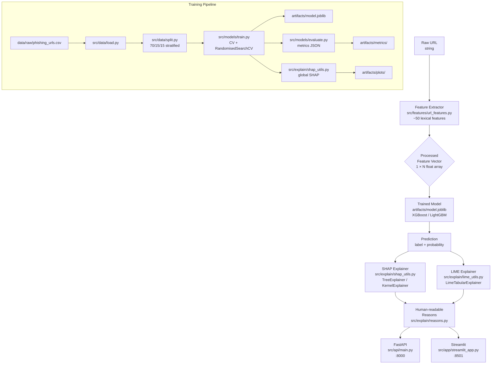

# System Architecture

## Overview

The Phishing XAI system is a modular, end-to-end ML pipeline. Data flows from raw URL strings through feature extraction, model inference, and XAI explanation, then out through two delivery surfaces: a REST API and an interactive Streamlit web application.

---

## Data Flow Diagram

---

## Module Descriptions

### `src/features/url_features.py`
Extracts ~50 URL features grouped into:
- **Lexical:** URL length, number of dots, hyphens, digits, special characters, entropy of hostname
- **Structural:** Has IP address, subdomain depth, path depth, file extension, query parameter count
- **Keyword-based:** Presence of suspicious keywords (login, secure, verify, bank, paypal, etc.)
- **TLD-based:** TLD type (generic/country/suspicious), registered domain length
- **Encoding:** Percent-encoding count, punycode detection

### `src/data/load.py`
Loads the raw CSV, validates columns, applies label encoding, and returns a clean `pandas.DataFrame`.

### `src/data/split.py`
Performs stratified train/validation/test split (70/15/15) with configurable random seed. Saves splits to `data/processed/`.

### `src/models/train.py`
Trains all configured models with 5-fold cross-validation and `RandomizedSearchCV`. Saves the best model to `artifacts/model.joblib` and exports `artifacts/feature_schema.json`.

### `src/models/evaluate.py`
Evaluates the saved model on the test set. Outputs JSON metrics and generates ROC curve, PR curve, and confusion matrix plots.

### `src/models/predict.py`
`PhishingPredictor` class: loads model + schema, runs the full predict pipeline (feature extraction → inference → explanation).

### `src/explain/shap_utils.py`
Wraps `shap.TreeExplainer` (for tree models) or `shap.KernelExplainer` (for others). Produces global summary plots and per-instance waterfall charts.

### `src/explain/lime_utils.py`
Wraps `lime.lime_tabular.LimeTabularExplainer`. Returns feature-weight pairs for a single prediction.

### `src/explain/reasons.py`
Converts raw SHAP/LIME weights into human-readable natural-language reason strings (e.g., "The URL contains an IP address instead of a domain name (+0.42 risk)").

### `src/explain/evaluate_explanations.py`
Quantitative XAI evaluation: **fidelity** (agreement between surrogate and black-box), **stability** (Jaccard similarity of top-k features across perturbations), and **completeness** (feature coverage).

### `src/api/main.py`
FastAPI application exposing `/predict`, `/health`, and `/docs` endpoints.

### `src/app/streamlit_app.py`
Interactive Streamlit dashboard: URL input → prediction gauge → SHAP waterfall chart → LIME bar chart → human-readable reasons panel.

---

## API Endpoints

| Method | Path       | Description                              | Request Body              | Response                                   |
|--------|-----------|------------------------------------------|---------------------------|--------------------------------------------|
| GET    | `/health`  | Liveness check                           | —                         | `{"status": "ok", "model_version": "..."}`  |
| POST   | `/predict` | Predict phishing label for a single URL  | `{"url": "..."}`          | `{"label": 0/1, "probability": float, "reasons": [...]}` |
| GET    | `/docs`    | Auto-generated Swagger UI                | —                         | HTML                                       |
| GET    | `/redoc`   | ReDoc documentation                      | —                         | HTML                                       |

---

## Configuration

All paths, model parameters, and XAI hyper-parameters are centralised in `config.yaml`. Scripts load it via `yaml.safe_load(open("config.yaml"))` and resolve paths relative to the project root.
